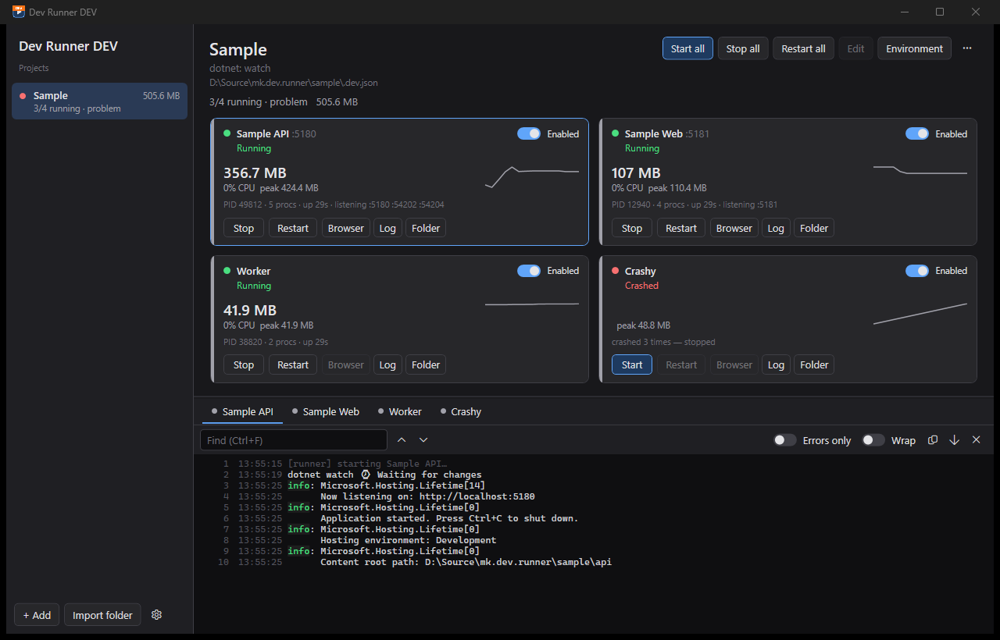
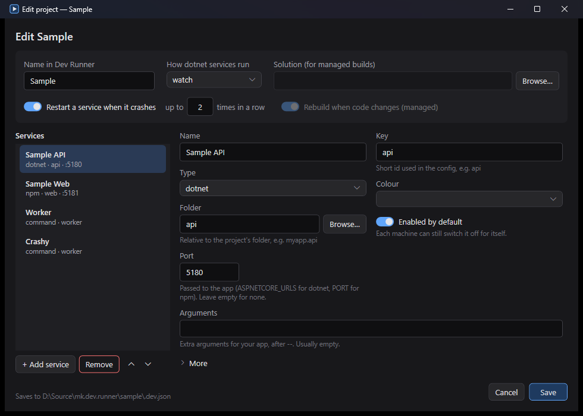

# Dev Runner

**Start everything your project needs with one click.**

Most projects need a few things running at once: a website, the server behind it, maybe a background job. Dev Runner runs them all from one window instead of a pile of terminals, and shows you what's running and what's broken.



- Start and stop everything with one button
- See each part's memory, status and logs
- Search the logs, or show only the errors
- Crashed parts can restart by themselves
- Closing Dev Runner closes everything it started

## Install

Download **DevRunner-win-Setup.exe** from the [latest release](https://github.com/mcknight89/mk.dev.runner/releases/latest) and run it. Windows 10 or 11.

## Get going

Click **+ Add**, choose your project's folder, then click **Start all**. If the project isn't set up yet, Dev Runner offers to do it. **Edit** changes what runs.



## Found a bug?

Click **Report a bug** in Settings or the tray menu. Say what went wrong, and remove any passwords before you send it.

## For developers

Runs dotnet (`watch`, `run` or managed builds), npm and any command. Each project has a `.dev.json` in its root:

```json
{
  "globals": { "dotnetMode": "watch" },
  "services": [
    { "key": "api", "name": "API", "type": "dotnet", "dir": "api", "defaultPort": 5180 },
    { "key": "web", "name": "Web", "type": "npm", "dir": "web", "defaultPort": 5181 }
  ]
}
```

**[How .dev.json works](docs/dev-json.md)**: every field, what each type runs, ports, health checks and dotnet modes.

Build with `build.cmd`, make an installer with `release.cmd 0.0.2`, and push a `v*` tag to publish a release. The `sample\` folder has a project to try.

MIT licence.
